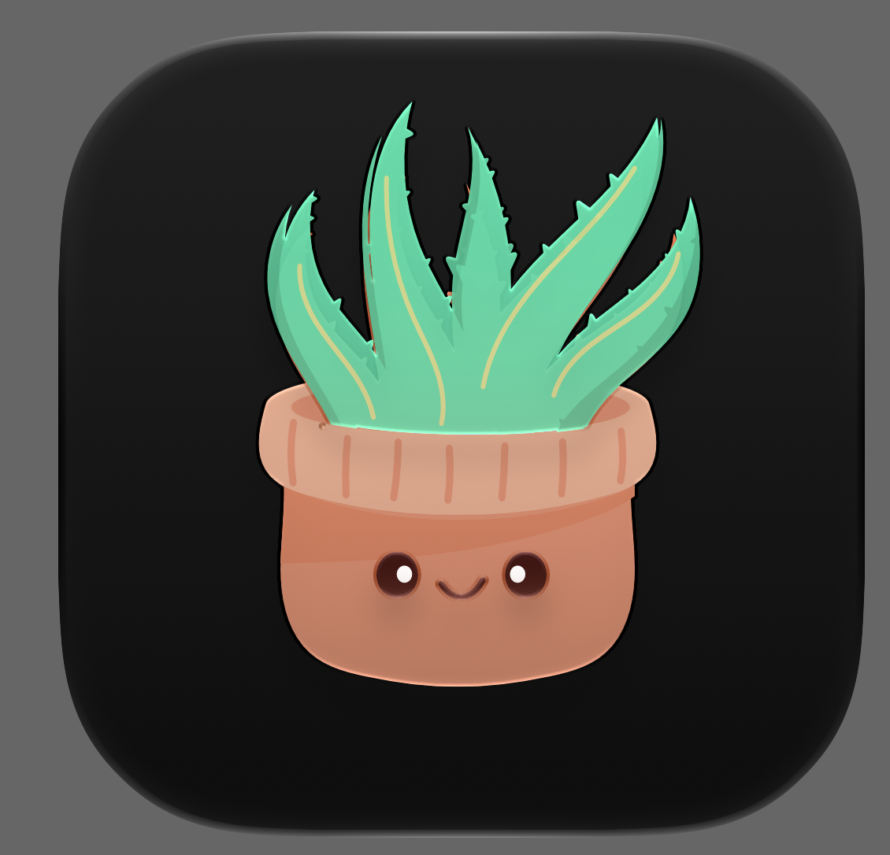
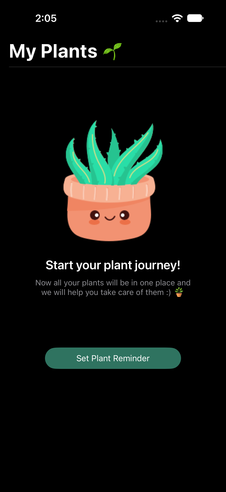
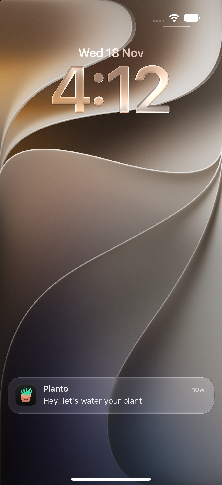

<div align="center">



# 🌱 Planto

### Never forget to water your plants again

A plant care reminder app built with **SwiftUI** and **MVVM**.


</div>

---

## 📱 Screenshots

<div align="center">

| Onboarding | No Reminders | Add Plant |
|:---:|:---:|:---:|
|  |  |  |

| My Plants | All Done | Notification |
|:---:|:---:|:---:|
|  |  |  |

</div>

## 🚀 Features

- 🌿 Add, edit, and delete plants (room, light, water amount, watering days)
- ✅ Check plants off and track daily progress with a live progress bar
- ⬇️ Watered plants move below pending ones
- 🎉 "All Done" state when every plant is watered
- 👆 Swipe to delete
- 🔔 Local notifications scheduled by watering interval

## 🏗 Architecture (MVVM)

```
Planto
├── Models        → Plant
├── ViewModels    → PlantsViewModel, NotificationManager
├── Views         → OnboardingView, PlantsListView, PlantRow, SetReminderView
└── Extensions    → Color+Plant
```

## 🔮 Next Steps

- Re-schedule notifications when the app opens

## ▶️ Run

1. Clone: `git clone https://github.com/ILLH44/Planto.git
2. Open `Planto.xcodeproj`
3. Run on an iPhone simulator (⌘R)

## 👩‍💻 Author

**Hanen Alharbi**
